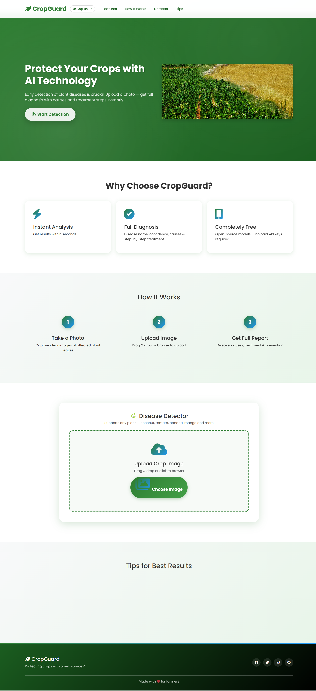

# 🌿 CropGuard – Plant Disease Detection

CropGuard is a web application that helps farmers identify plant diseases from a single leaf photo.
Upload an image and get an instant diagnosis with the plant name, disease, severity, causes,
treatment steps, recommended medicines and prevention tips, in your own language.

Backend: **Java 17 + Spring Boot** · Frontend: **HTML, CSS, JavaScript, Bootstrap** · Analysis: **Google Gemini API**

---

## 📸 Screenshots




---

## ✨ Features

- 📷 Upload a leaf/crop photo by drag & drop or file picker, with live preview
- 🔍 Detects the plant and the disease, with a confidence score and severity level
  (none / moderate / severe / critical)
- 💊 Gives causes, step-by-step treatment, medicine suggestions with dosage, and prevention tips
- 🌐 Multilingual interface and results: English, Hindi, Marathi, Tamil, Telugu, Punjabi, Kannada, Gujarati
- 🔊 Read-aloud support for results (browser text-to-speech)
- 🚫 Rejects non-plant images with a clear message
- 📱 Responsive design for mobile and desktop
- 🔒 API key kept out of the source code (environment variable or local file)

---

## 🛠️ Tech Stack

| Layer       | Technology                                         |
|-------------|----------------------------------------------------|
| Backend     | Java 17, Spring Boot 3 (Web), Maven                |
| HTTP / JSON | `java.net.http.HttpClient`, Jackson                |
| AI service  | Google Gemini API (`gemini-2.5-flash`), REST       |
| Frontend    | HTML5, CSS3, JavaScript, Bootstrap 5, Font Awesome |

---

## ⚙️ How It Works

```
Browser (index.html + script.js)
        │  POST /analyze  (image + language)
        ▼
AnalyzeController  ── validates file type & size
        │
        ▼
GeminiService  ── sends image + prompt to Gemini API
        │
        ▼
JSON result  ──►  displayed as a diagnosis card in the browser
```

---

## 📋 Prerequisites

- **JDK 17 or newer** – https://adoptium.net
- **Apache Maven 3.8+** – https://maven.apache.org/download.cgi
  (not needed separately if you use IntelliJ IDEA or VS Code with the Java extension pack)
- **Gemini API key** – free from https://aistudio.google.com/apikey

Check your setup:
```bash
java -version
mvn -version
```

---

## 🚀 Getting Started

### 1. Clone the repository
```bash
git clone https://github.com/Talimuddin/CropGuard.git
cd CropGuard
```

### 2. Add your Gemini API key (choose one method)

**Option A – Environment variable**

```bash
# Windows (CMD)
set GEMINI_API_KEY=your_api_key_here

# Windows (PowerShell)
$env:GEMINI_API_KEY="your_api_key_here"

# Linux / macOS
export GEMINI_API_KEY=your_api_key_here
```

**Option B – `local.properties` file**

Copy `local.properties.example` to `local.properties` and paste your key:
```properties
gemini.api-key=your_api_key_here
```
> `local.properties` is listed in `.gitignore`, so your key will never be committed.

### 3. Run the application
```bash
mvn spring-boot:run
```
Or use `run.bat` (Windows) / `./run.sh` (Linux, macOS).

Open **http://localhost:5000** in your browser.

### Build a runnable JAR (optional)
```bash
mvn clean package
java -jar target/cropguard-1.0.0.jar
```

---

## 🔌 API Reference

### `POST /analyze`

Content type: `multipart/form-data`

| Field   | Type   | Description                                                                          |
|---------|--------|--------------------------------------------------------------------------------------|
| `image` | file   | Leaf/crop photo (png, jpg, jpeg, gif, webp – max 16 MB)                              |
| `lang`  | string | Result language code: `en`, `hi`, `mr`, `ta`, `te`, `pa`, `kn`, `gu` (default `hi`) |

**Success – `200 OK`**
```json
{
  "result": {
    "plant_name": "Tomato",
    "is_plant": true,
    "is_healthy": false,
    "disease_name": "Early Blight",
    "confidence": 92,
    "severity": "moderate",
    "causes": ["..."],
    "treatment": ["..."],
    "medicine": ["..."],
    "prevention": ["..."]
  }
}
```

**Error** – `400 / 413 / 500`
```json
{ "error": "Description of what went wrong" }
```

---

## 📁 Project Structure

```
CropGuard/
├── pom.xml                              Maven configuration
├── local.properties.example             Template for your API key
├── run.bat / run.sh                     Quick start scripts
├── Screenshots/                         App screenshots
└── src/main/
    ├── java/com/cropguard/
    │   ├── CropGuardApplication.java    Application entry point
    │   ├── AnalyzeController.java       POST /analyze endpoint + validation
    │   ├── GeminiService.java           Gemini API integration
    │   ├── GeminiException.java         Custom exception with HTTP status
    │   └── GlobalExceptionHandler.java  Consistent JSON error responses
    └── resources/
        ├── application.properties       Port, upload limit, model name
        └── static/                      index.html, style.css, script.js, translations.js
```

---

## 🔧 Configuration

Settings in `src/main/resources/application.properties`:

| Property                                 | Default            | Description          |
|------------------------------------------|--------------------|----------------------|
| `server.port`                            | `5000`             | Port the app runs on |
| `spring.servlet.multipart.max-file-size` | `16MB`             | Maximum image size   |
| `gemini.model`                           | `gemini-2.5-flash` | Gemini model used    |
| `gemini.timeout-seconds`                 | `90`               | Request timeout      |

---

## ❓ Troubleshooting

| Problem                     | Solution                                                                        |
|-----------------------------|---------------------------------------------------------------------------------|
| "Gemini API key is not set" | Set `GEMINI_API_KEY` or create `local.properties`, then restart the server      |
| "API key was rejected"      | Re-copy the full key with no spaces or quotes; restart after changing it        |
| "Free-tier limit reached"   | The free plan allows only a few requests per minute – wait a minute and retry   |
| Port 5000 already in use    | Change `server.port` in `application.properties`                                |
| `mvn` not recognized        | Install Maven and add its `bin` folder to PATH, or run from IntelliJ / VS Code  |

---

## 🔮 Future Improvements

- User login and scan history (Spring Security + database)
- Result caching and rate limiting
- Docker support and cloud deployment
- Mobile app using the same API

---

## 📄 License

This project is licensed under the MIT License. See the [LICENSE](LICENSE) file for details.

## 👤 Author

Talimuddin – [GitHub](https://github.com/Talimuddin)
